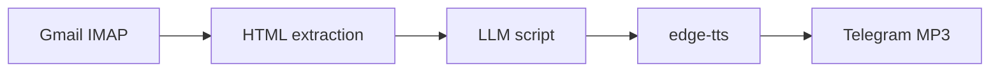

# rAIdio

[](https://github.com/louismartino/rAIdio/actions/workflows/ci.yml)

**Turn your morning newsletters into a personal radio show, allowing you to listen during your commute instead of reading at your desk.**

I subscribe to several newsletters to stay informed but reading them meant losing focused work time in front of a screen. rAIdio automates the entire flow by fetching the day's emails, summarizing them into a natural spoken script with an LLM and synthesizing the audio. An MP3 is then delivered directly to Telegram, allowing me to listen while walking to work or class.

---

## How it works



1. **Fetch**: Connects to a Gmail folder via IMAP and pulls newsletters for a given date.
2. **Generate**: Sends the cleaned content to a configurable LLM (Gemini by default) with a customizable prompt template.
3. **Synthesize**: Converts the script to speech with [edge-tts](https://github.com/rany2/edge-tts).
4. **Deliver**: Sends the audio file to a Telegram chat.

If anything fails along the way, you get a descriptive error message on Telegram instead of silence.

---

## Features

- **Date-aware fetching**: Process today's newsletters or any specific date.
- **Pluggable LLM**: Provider registry (`LLM_PROVIDER`, `LLM_MODEL`).
- **Externalized prompt**: Edit `prompts/radio_script.fr.txt` without touching code.
- **Ordered digest**: `NEWSLETTER_ORDER` controls how sources are woven into one coherent script.
- **Web UI**: Minimal FastAPI page: API key, optional date, one button.
- **CLI**: `raidio` for local runs and automation.
- **GitHub Actions**: Trigger the pipeline from your phone via `workflow_dispatch`.
- **Strict config**: Pydantic Settings with `SecretStr`; missing env vars fail fast at startup.
- **Tested**: pytest suite with mocked I/O; CI runs ruff, mypy, and tests on every push.

---

## Tech stack

| Layer | Choice |
|-------|--------|
| Language | Python 3.10+ |
| API | FastAPI + uvicorn |
| Config | pydantic-settings |
| Email | imapclient + BeautifulSoup |
| LLM | google-genai (Gemini) |
| TTS | edge-tts |
| Delivery | python-telegram-bot |
| Quality | ruff, mypy (strict), pytest |

---

## Getting started

### Prerequisites

- Python 3.10+
- A Gmail account with IMAP enabled and an [App Password](https://support.google.com/accounts/answer/185833)
- A Telegram bot token and your chat ID
- An LLM API key (e.g. Google Gemini)

### Installation

```bash
git clone https://github.com/louismartino/rAIdio.git
cd rAIdio
python -m venv .venv
source .venv/bin/activate   # Windows: .venv\Scripts\activate
pip install -e ".[dev]"
```

### Configuration

```bash
cp .env.example .env
```

Fill in every value in `.env`. All variables are required — the app will not start if any are missing or empty.

| Variable | Description |
|----------|-------------|
| `LLM_PROVIDER` | LLM backend (`gemini`) |
| `LLM_MODEL` | Model name |
| `LLM_API_KEY` | LLM API key |
| `EMAIL_USER` / `EMAIL_PASS` | Gmail address and app password |
| `TELEGRAM_TOKEN` / `TELEGRAM_CHAT_ID` | Bot credentials and target chat |
| `USER_FIRST_NAME` | Used in the radio script greeting |
| `NEWSLETTER_ORDER` | Semicolon-separated newsletter names, in order |
| `NEWSLETTER_LIMIT_NAME` / `NEWSLETTER_LIMIT_COUNT` | Cap verbose sources |
| `PROMPT_TEMPLATE_PATH` | Path to the prompt template file |
| `TTS_VOICE` / `TTS_RATE` | edge-tts voice and speaking rate |
| `FASTAPI_API_KEY` | Secret key for the web UI and API |

---

## Usage

### Web UI (local)

```bash
uvicorn main:app --host 127.0.0.1 --port 8000
```

Open [http://127.0.0.1:8000](http://127.0.0.1:8000), enter your API key, pick a date if needed, and click **Run process**.

### CLI

```bash
raidio
```

Process a specific date:

```bash
TARGET_DATE=2026-06-08 raidio
```

### GitHub Actions (no local machine required)

1. Configure **Secrets** and **Variables** in your repo settings (see `.github/workflows/main.yml`).  
   Required secrets: `GEMINI_API_KEY`, `EMAIL_USER`, `EMAIL_PASS`, `TELEGRAM_TOKEN`, `TELEGRAM_CHAT_ID`, `FASTAPI_API_KEY`.
2. Go to **Actions → Morning Radio → Run workflow**.
3. Optionally set a `target_date` (`YYYY-MM-DD`).

---

## Project structure

```
rAIdio/
├── main.py                  # FastAPI app + web UI entrypoint
├── src/
│   ├── pipeline.py          # Orchestration
│   ├── newsletter_fetcher.py
│   ├── script_generator.py
│   ├── telegram_client.py
│   ├── config.py
│   ├── api/                 # Auth + web UI
│   └── llm/                 # Pluggable LLM providers
├── prompts/
│   └── radio_script.fr.txt  # Editable LLM prompt template
├── tests/
└── .github/workflows/       # CI + manual pipeline trigger
```

---

## Development

```bash
pip install -e ".[dev]"
ruff check .
ruff format --check .
mypy src
pytest
```

---

## License

[MIT](LICENSE)
